# MCQ Tracker

MCQ Tracker is the question-first study plugin for Obsidian. Turn notes and PDFs into exam-style practice across seven question formats, review notes and cards with spaced repetition, sit timed tests, and keep every attempt on the note it came from. It is free, local-first, and works on desktop and mobile. No MCQ Tracker account is required; AI is optional and uses your own provider key or the OpenCode desktop agent.

[Website](https://ifriedenson.github.io/mcq-tracker/) · [Source](https://github.com/ifriedenson/mcq-tracker) · [Give feedback](https://tally.so/r/PRDe1d)

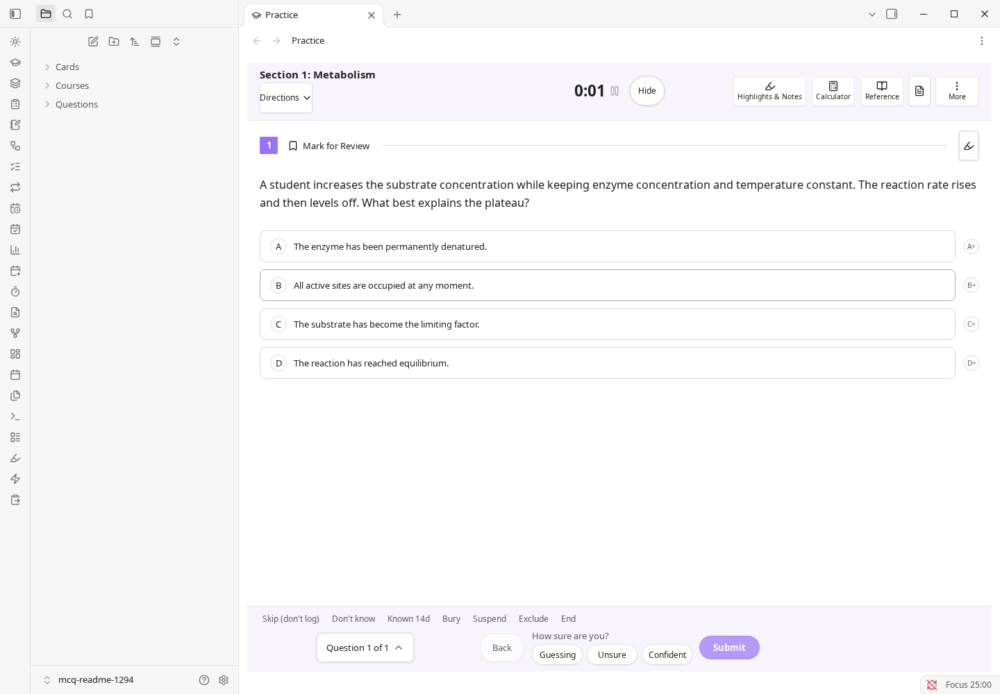

## Where to start

| You are... | Start here |
| --- | --- |
| Already using Obsidian | [For Obsidian users](#for-obsidian-users) |
| A student who has never heard of Obsidian | [For students new to Obsidian](#for-students-new-to-obsidian) |

Both paths end at the same place: your first practice question. **Settings** and **Troubleshooting** appear once below, and the deeper feature reference is in [Reference](#reference).

## What it does

- **Practise exam-style questions.** Multiple-choice, student-produced response, fill-in, matching, true/false, select-all and free-response (FRQ) questions. Filter by course, skill, difficulty, folder or a saved preset, or build a timed test.
- **Check every answer.** See your pick, the correct answer, the explanation, your confidence and the next review date. Add a reason for a miss and write a note on the result.
- **Review on a schedule.** By default a correct answer returns after 1, 3, 7, 21 and 60 days; a miss returns tomorrow. Cards and whole notes can use the same default ladder, or FSRS/SM-2. The optional Cards module adds flashcards, vocabulary and cloze cards.
- **Plan and measure.** Calendar (optional) holds classes and exams; Assignments (on by default) holds deadlines and grades. Insights shows attempts, accuracy, due counts and weak spots from your local notes.
- **Import your own material.** Document import turns PDF, PowerPoint, Word/OpenDocument, HTML, RTF, Markdown, CSV or text into question notes, but **it requires AI features plus either a provider key or the OpenCode desktop agent. There is no offline converter.** Ready-made card imports are separate and work locally.
- **Ask for help when you want it.** The optional Study agent is a note-grounded tutor with tutor roles, local cited vault search, PDF context and review-before-write file changes.

| Cards and vocabulary | Insights |
| --- | --- |
| <a href="docs/images/cards-review.png">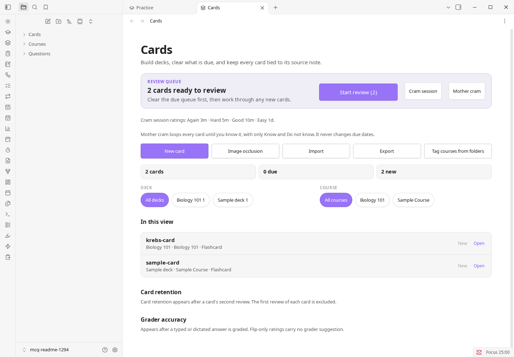</a> | <a href="docs/images/insights-overview.png">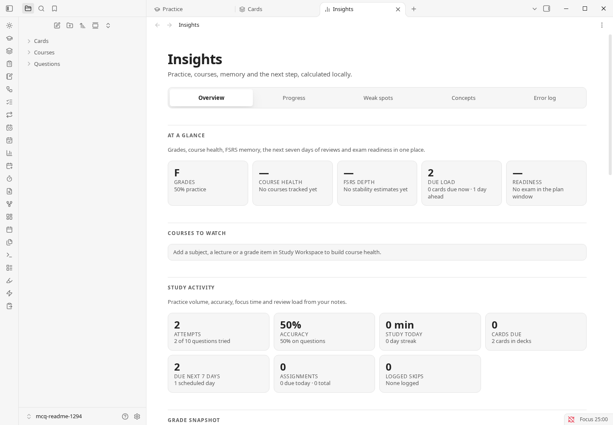</a> |

## What needs AI, and what does not

Most of MCQ Tracker works with AI turned off. One everyday workflow does not: **turning a PDF or another document into question notes. There is no offline converter.**

> **Document import needs AI.** **Import questions from a file (PDF, PowerPoint, Word)** needs **AI features** turned on, plus either a **Direct API** provider key or the **OpenCode agent** on desktop. The file's text is sent to that provider, which may charge for long files. Without AI set up, the import checks the file first, then asks you to connect a provider.

| Works with AI off | Needs AI turned on and a provider or the OpenCode agent |
| --- | --- |
| Writing question notes by hand, the example question, practice, timed tests, review and **Today** | Turning a PDF, PowerPoint, Word/OpenDocument, HTML, RTF, Markdown, CSV or text file into question notes |
| Making cards by hand, card review, cram, `.apkg` import/export and AnkiConnect | Tutor chat and the Study agent; AI grading of free response and the optional AI second opinion on typed answers |
| Calendar, classes, exams, assignments, grades and GPA | Generating questions, quizzes or cards from a document, photo or handwritten page |
| Reference tools, AP resources and the unofficial AP score calculator | Summarising a course note, and turning PDF pages into a LaTeX note |
| Ready-made card imports: Quizlet, Kahoot, Moodle XML, QTI, GIFT, CSV, Markdown, `.apkg`, CrowdAnki JSON, Mochi Markdown and Anki text | AI-assisted import with the OpenCode agent |

**If you do not have AI:** run **Quick add questions from pasted text** and paste questions you already have; it works offline. You can also import ready-made flashcards, write question notes by hand, and use practice, review, cards, the calendar and the reference tools normally.

## For Obsidian users

### Install

**Desktop:** open **Settings → Community plugins → Browse**, search for `MCQ Tracker`, then **Install → Enable**.

**From the website:** open https://community.obsidian.md/plugins/mcq-tracker and choose **Add to Obsidian**. If Obsidian does not open the listing, use the **Browse** path above.

**Mobile:** open the sidebar, go to **Settings → Community plugins**, turn off Restricted mode, then **Browse → `MCQ Tracker` → Install → Enable**. Close Settings when you are done.

Once enabled, **Settings → Community plugins** lists the installed plugin and version:

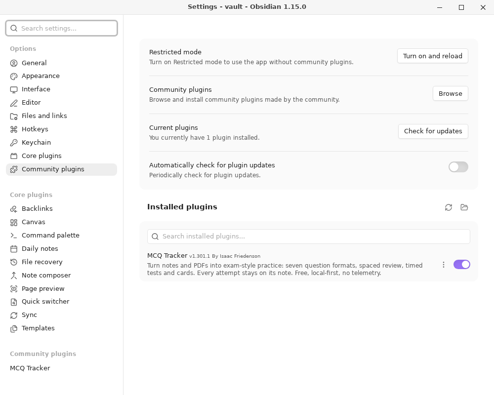

<details>
<summary><strong>Manual install or offline</strong></summary>

Download `main.js`, `manifest.json` and `styles.css` from the [latest release](https://github.com/ifriedenson/mcq-tracker/releases/latest) and put them in `<your vault>/.obsidian/plugins/mcq-tracker/`. Then enable **MCQ Tracker** under Community plugins.

</details>

<details>
<summary><strong>Update later</strong></summary>

Use **Check for updates** on the Community plugins page. If you installed manually, download the three files from the [latest release](https://github.com/ifriedenson/mcq-tracker/releases/latest) and replace the copies in `<your vault>/.obsidian/plugins/mcq-tracker/`.

</details>

### How it fits your vault

- **Questions are ordinary notes.** Any note with a `question_id` property can be a question. There is no database and no proprietary format.
- **Your results live in your notes.** Attempts, dates, flags and review dates are written to the question note's properties, so you can query them with Bases or Dataview.
- **The plugin's `data.json`** stores settings, presets, the running timer, local events, chat history and other plugin state. Your other notes stay ordinary Markdown.
- **Main modules have clear defaults.** MCQ Tracker and Assignments are on by default. Cards and vocabulary, Calendar and AI features are opt-in; turn them on under **Settings → App & documents → Modules and global options → Modules**.
- **Optional integrations stay optional.** AI, AnkiConnect, CouchDB sync and calendar feeds do nothing until you turn them on and configure them.

### Question note format

A small question note looks like this:

```markdown
---
question_id: BIO-001
course: Biology
skill: Cells
question_type: mcq
answer: B
---

## Question
Which organelle produces most of the cell's ATP?

## Answer Choices
- A. Nucleus
- B. Mitochondrion
- C. Ribosome

## Answer
> [!answer]- Reveal answer
> **Correct Answer: B**
>
> Mitochondria produce ATP by oxidative phosphorylation.
```

`## Stimulus` is optional. You can also add `difficulty`, `unit` and `test` properties, and use `## My Notes` for your own notes. See the [sample vault](samples/README.md) for working notes.

### Quick start

1. After you install and enable the plugin, close the **Community plugins** window. On the first run, the **MCQ Tracker Start here** note opens in the main Obsidian window automatically. If it does not, press `Ctrl/Cmd+P`, type **Open Start here note**, and press Enter.
2. Follow the note's path for you. It has a five-minute Obsidian primer, an AP student path, a shortest route for Obsidian users, and power-user shortcuts.
3. To use the clickable example, press `Ctrl/Cmd+P`, type **Open welcome guide**, and press Enter. Click **Try the example question**. It writes one ordinary note under `Questions/` and opens Practice on that question. **Open Start here note** opens the Markdown guide; **Open welcome guide** opens this modal.
4. Choose an answer, pick how sure you are, and click **Submit**.
5. Read the result. The note keeps your answer, the correct answer, the explanation and the next review date.
6. Open **Today** to see what is due next, or **Open practice** to start another question.

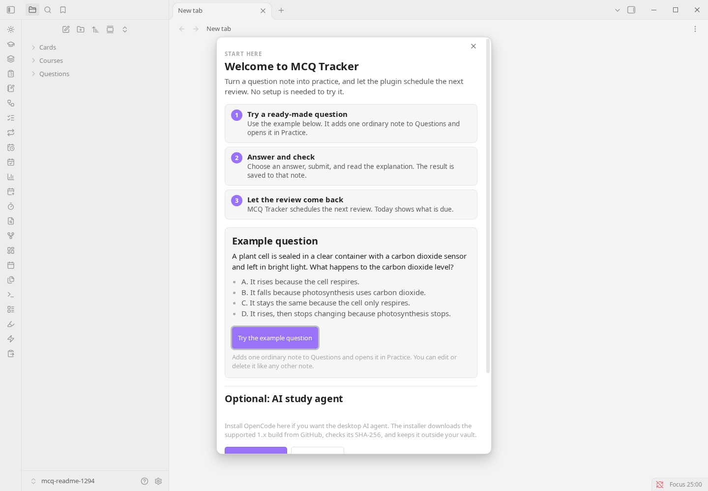 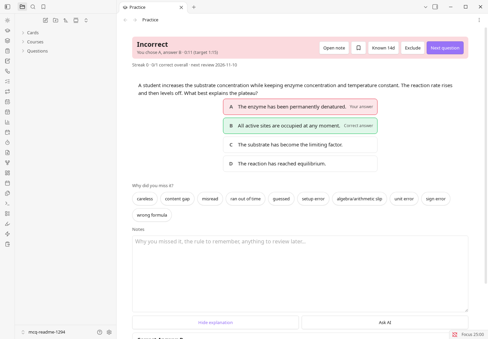

Reopen the note any time with **Open Start here note**. The interactive guide is still available as **Open welcome guide**. After an update, a short **What's new** note lists that version's changes once; reopen it with **Show what's new**.

### Privacy and network use

The plugin sends no telemetry. The optional AI and CouchDB sync features use the network only after you turn them on and configure them. AnkiConnect talks only to a local Anki desktop. Full details are in [Data, privacy and network use](#data-privacy-and-network-use).

## For students new to Obsidian

You do not need to know anything about Obsidian, programming or note-taking apps. This section goes from nothing to your first practised question and takes about 10 minutes.

### What are Obsidian and MCQ Tracker?

- **Obsidian** is a free note-taking app. It keeps your notes as plain files in a folder on your device. That folder is called a **vault**.
- **MCQ Tracker** is an add-on (Obsidian calls these **community plugins**) that turns your notes into a practice tool. You answer practice questions, and it tells you when to review each one again.
- **Spaced repetition** means reviewing something just before you would forget it, with the gaps getting longer each time. Get a question right and it comes back after 1, 3, 7, 21, then 60 days by default. Get it wrong and it comes back tomorrow.
- You do not need an MCQ Tracker account, and Obsidian does not need one either.

### Step 1: Get Obsidian

1. Go to [obsidian.md/download](https://obsidian.md/download) and install Obsidian. On a phone or tablet, install it from your app store.
2. Open it. You should see the vault picker.
3. Create a vault: choose **Create new vault**, give it a name (for example `Study`), pick a folder, and open it. You should see an empty file list on the left and a blank note area.

### Step 2: Install MCQ Tracker

1. Click the **gear** at the bottom-left to open **Settings**. On mobile, open the sidebar and tap **Settings**.
2. Choose **Community plugins**. You should see **Restricted mode** turned on. This is Obsidian's safety setting.
3. Click **Exit Restricted mode** and confirm. You should now see **Browse** and **No plugins installed**.
4. Click **Browse**, search for `MCQ Tracker`, and open the result. You should see a page with an **Install** button.
5. Click **Install**, then **Enable**. Close **Settings** to return to the main Obsidian window.

Once enabled, **Settings → Community plugins** lists the installed plugin and version:


On desktop you can also open https://community.obsidian.md/plugins/mcq-tracker and choose **Add to Obsidian**. The manual install route is under [Install](#install).

### Step 3: Answer your first question

1. On the first run, the **MCQ Tracker Start here** note opens in the main Obsidian window automatically. If it does not, press `Ctrl/Cmd+P` (Windows/Linux) or `Cmd+P` (Mac), type **Open Start here note**, and press Enter. On mobile, use the command palette the same way.
2. The Start here note is a Markdown guide with four paths. For the clickable example, press `Ctrl/Cmd+P`, type **Open welcome guide**, and press Enter, then click **Try the example question**. This is the welcome modal, not the note.
3. Pick an answer, choose how sure you are, and click **Submit**.
4. Read the result. It shows your answer, the correct one, the explanation and the date the question will come back.

 

### Step 4: Come back tomorrow

Open Obsidian and click **Today**. It lists the questions that are due for review. Do those first, then practise something new. That daily habit is the whole method.

### Getting your own questions in

- **Import a document.** This turns a PDF, PowerPoint, Word/OpenDocument, HTML, RTF, Markdown, CSV or text file into question notes, but **it needs AI features plus either a provider key or the OpenCode desktop agent, and there is no offline converter.** The file's text is sent to that provider, which may charge for long files.
- **Import ready-made cards.** This route is local and separate from document import: Quizlet, Kahoot, Moodle XML, QTI, GIFT, CSV, Markdown, `.apkg`, CrowdAnki JSON, Mochi Markdown and Anki text.
- **Write your own.** Each question is a short note. The [sample vault](samples/README.md) has working examples to copy.
- **No AI?** Run **Quick add questions from pasted text**, import ready-made cards, or use the example question. Practice, review, cards, the calendar and the reference tools all keep working.

### Beyond multiple choice (optional)

These are off until you switch them on under **Settings → App & documents → Modules and global options → Modules**, except Assignments, which is already on:

- **Cards and vocabulary** adds flashcards, vocabulary, cloze and other card types, using the default ladder or FSRS/SM-2.
- **Calendar** adds your classes and exams, and plans study around them.
- **Assignments** keeps deadlines and grades.
- **AI features** adds the tutor, grading and AI-assisted import. It needs your own provider key or the OpenCode desktop agent, so skip it unless you want it.

### Words you will see

| Word | Meaning |
| --- | --- |
| Vault | The folder where Obsidian keeps all your notes. |
| Note | One file in your vault. Each question is one note. |
| Community plugin | An add-on you install inside Obsidian. MCQ Tracker is one. |
| Properties | Small labelled fields at the top of a note, such as `course` or `answer`. |
| MCQ | Multiple-choice question. |
| FRQ | Free-response question, where you write your own answer. |
| Cloze card | A flashcard with a blank for you to fill in. |
| Spaced repetition | Reviewing at growing intervals so you remember for longer. |

### Your notes stay yours

Everything is stored as normal files in your vault folder on your own device. The plugin sends no telemetry, and AI and sync features do nothing on the network until you turn them on. The full explanation is in [Data, privacy and network use](#data-privacy-and-network-use).

## Settings

Settings are grouped by category, with a page list beside the selected category. The most useful starting switches are under **Settings → App & documents → Modules and global options → Modules**. MCQ Tracker and Assignments are on by default; Cards and vocabulary, Calendar and AI features are opt-in.

| Setting | What it does | Default |
| --- | --- | --- |
| MCQ Tracker | Turns practice, tests, filters and import on or off. Notes stay. | On |
| Cards and vocabulary | Adds flashcards, vocabulary and card review. | Off |
| Calendar | Adds classes, exams and exam-aware study planning. | Off |
| Assignments | Adds the gradebook and task list. | On |
| AI features | Adds tutor, grading and AI-assisted import. Needs your key or the OpenCode desktop agent. | Off |
| Review intervals (days) | Days before a correct answer returns. Misses return tomorrow. | 1, 3, 7, 21, 60 |
| Explanation after answering | When to show the answer explanation. | Only after a miss |

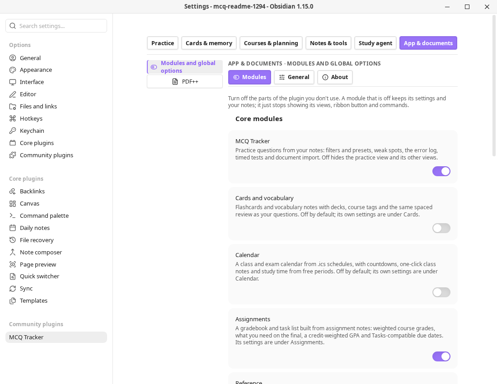

<details>
<summary>Advanced settings and modules</summary>

The optional Study Workspace adds **twenty-one independent modules** and **twenty-one local workflows**, including Feynman, Recall, Time blocks, Reading library and Quiz index. Its settings are on their own pages.

Other settings pages include **Whole-note review**, **Spaced Everything**, **Daily quiz**, **Simple quiz blocks**, **Simple note quiz**, **Decks**, **AnkiConnect**, **CouchDB sync**, **Auto Anki** and **Text2Anki**. Each has its own page or tab.

</details>

## Troubleshooting

- **I cannot find MCQ Tracker in Browse.** Check that Restricted mode is off, Obsidian is up to date, and the search is `MCQ Tracker`. If it still does not appear, use the manual install above.
- **Practice says there are no questions.** Each question note needs a `question_id` property, a `## Question` heading and an `answer` property. Check **Question folder** in the plugin's Practice settings and clear any folder filter.
- **Cards are missing.** Cards and vocabulary is off by default. Turn it on under **Settings → App & documents → Modules and global options → Modules**.
- **AI or OpenCode does not work.** AI features are off by default. Turn them on under **Settings → App & documents → Modules and global options → Modules**, then add a provider key under **Settings → Study agent → AI and the assistant**. OpenCode is desktop-only; on mobile, use a Direct API provider key.
- **A result did not save.** Keep Obsidian open, press `Ctrl/Cmd+P`, and run **Retry saving offline practice results**. Check that the vault folder is writable.

## Reference

The sections below are the full reference. The two paths above are enough to start.

### Why MCQ Tracker

- **It starts with questions, not a deck to maintain.** Write or import questions, answer them, and let the review schedule follow the result. You can still add whole notes and cards when that is the better unit.
- **It tells you why you missed.** Confidence ratings, mistake tags, per-skill accuracy, weak-spot practice, answer explanations and a review date all stay on the question note.
- **It covers the whole exam week.** Timed multi-section tests, AP-style free response, a gradebook, exam-aware study plans and a calendar sit beside the question bank.
- **Your notes are the database.** Review state lives in each note's properties, so it travels with the vault, survives a plugin reinstall, and remains readable by Dataview or a text editor.
- **The optional parts stay optional.** AI, AnkiConnect, CouchDB sync and the calendar feeds are off or unused until you turn them on. Nothing is sent anywhere by default.

### What you get

| Area | Included |
| --- | --- |
| **Practice** | Multiple choice, student-produced response, fill-in, matching, true/false, select-all and free response (FRQ); hints, confidence, cross-out, flags and per-question timing. |
| **Tests** | Timed multi-section tests, resume, a question navigator, mark for review, option shuffle, a pass mark and Bluebook-style tools. |
| **Review** | Whole-note review in a dock under the note, a review sidebar, a due-date calendar, FSRS, SM-2 and the interval ladder; Again/Hard/Good/Easy previews, keyboard grading, requeue, skip, postpone, undo and lapse checkpoints. |
| **Cards** | Flashcards, cloze, reversed, multiple-choice, typed and image-occlusion cards; decks, vocabulary, cram, `.apkg` import/export and optional AnkiConnect sync. |
| **Study agent** | Optional note-grounded chat with tutor roles, an **Objective coach** role, local cited vault search, PDF context, plan-then-act, write review, memory and saved conversations. |
| **Study tools** | Feynman sessions, recall queues, Cornell notes, study flow, reading library, mind maps, study plans, time blocks, citations and reference sheets. |
| **Calendar** | Classes and exams from `.ics` or Full Calendar notes, local event CRUD with categories and recurrence, assignment deadlines, grades and study planning. |
| **Statistics** | Attempts, accuracy, confidence calibration, weak spots, study activity, true retention by maturity, memory-now, distributions, leeches and per-deck summaries. |
| **Import/export** | Document-to-question import (AI required), local card imports (Quizlet, Kahoot, Moodle, QTI, GIFT, `.apkg`, CrowdAnki JSON, Mochi Markdown, Anki text), and study-bundle, card-archive, `.apkg`, ICS, CSV, Markdown or JSON export where supported. |
| **Focus** | Pomodoro timer with work/short-break/long-break phases, a completion sound, a daily goal and a study log. |

 

### Practice, tests and feedback

Practice is one note per question by default, which keeps each attempt, explanation and review date attached to the material it belongs to. Quick add can turn a pasted block into several notes at once, and the importers can bring in a whole question bank.

- **Question types:** MCQ, SPR, fill-in, matching, true/false, select-all and FRQ.
- **Feedback:** the correct answer, the explanation, your confidence, an optional reason for a miss, mistake tags and the next review date.
- **Tests:** choose sections, counts, minutes, written responses, option shuffle and a pass mark; pause or resume a saved test.
- **Weak spots:** filter by course, skill, difficulty, folder or a saved preset, or use adaptive practice to weight the questions that need work.
- **Exam tools:** calculator, reference sheet, periodic table, formula sheet, highlighter, cross-out and mark-for-review.

### Review and scheduling

The review schedule is shared by questions, cards and whole notes. Nothing is locked behind a second account or a cloud service.

- **Whole-note review** opens the note in place and docks a grading bar underneath it. Every grade shows the interval it would schedule before you press it. A failed note returns later in the same session; a note that keeps failing stops at a lapse checkpoint and asks whether to reset, rest, remove or carry on.
- **The review sidebar** lists what is due and upcoming, groups by day, shows an estimate and lets you sort, filter, grade, postpone or remove without leaving the note. It can also show the Pomodoro clock.
- **The review calendar** shows the due load by day and the next seven days of work.
- **FSRS and SM-2** are both available for whole notes and cards. The interval ladder remains the default for questions; cards and whole notes can use the default ladder or FSRS/SM-2.
- **Durable recall** is opt-in: a correct recall counts as durable only after it happens on two different days.

### Cards, decks and Anki

The optional Cards module adds flashcards without changing the question workflow.

- **Card shapes:** flip, reversed pair, multiple choice, cloze, typed answer and image occlusion.
- **Decks and vocabulary:** deck folders, course tags, a vocabulary tab and an offline WordNet import.
- **Anki files:** import `.apkg`, export `.apkg`, and keep decks in step with a running Anki desktop through the AnkiConnect add-on.
- **AnkiWeb finder:** **Cards: find a deck on AnkiWeb** opens AnkiWeb's shared-deck search in your browser. Download the `.apkg` there and use **Cards: import existing decks**. The plugin does not ask for or store an AnkiWeb password.
- **Card review:** cram, a practice-only Mother cram loop, grading accuracy, a grade-later queue and a card archive.

### Study agent and study tools

AI is off by default and only uses the provider you configure. The Study agent is a normal Obsidian chat with local note grounding and a review window around file writes.

- **Tutor roles:** Private tutor, Socratic tutor, Objective coach and Language partner, plus `/guide`, `/quiz`, `/confuse`, `/gap`, `/predict`, `/feynman` and `/mock`.
- **Objective coach:** charts a note into learning objectives and teaches one at a time through explain → recall → apply. It tracks understanding, recall and transfer separately, treats recall as durable only after two different days, and can finish with a report you save as study notes and cards. The session lives in a saved conversation; there is no separate objective rail.
- **Grounded help:** local cited vault search, note attachment, PDF page ranges and opt-in memory. The agent is told to cite a real `[[note]]` or `[[note#L12]]` and to say when the vault does not contain the answer.
- **Study workspace:** twenty-one independent modules and twenty-one local workflows, including Feynman, Recall, Time blocks, Reading library and Quiz index. It also includes study maps, mind maps, Cornell notes, study flow, the subject manager, task lists, citations and read-aloud.
- **Writes stay reviewed:** the agent proposes a file change, you approve it, and the existing diff/undo guard applies it.

### Calendar, assignments and planning

- **Classes and exams:** import an `.ics` schedule, read Full Calendar notes, see the next class, mark attendance and create a class note.
- **Local events:** create, edit and delete events with seven colour-coded categories, custom colours, all-day or timed events, location, description and daily/weekly/monthly/yearly recurrence with an end date. They live in plugin data and are separate from imported feeds.
- **Assignments:** due dates, estimates, task checkboxes, a gradebook and GPA.
- **Planning:** Today, a study plan for the next exam, time blocks, deadlines and a calendar view.

### Import and export

Bring material in as notes, not as a locked database.

**Document import (needs AI).** PDF, PowerPoint (`.pptx`, `.pptm`, `.ppsx`), Word (`.docx`, `.docm`), OpenDocument (`.odt`, `.odp`), HTML (`.html`, `.htm`), RTF, Markdown (`.md`, `.markdown`), CSV/TSV and plain text (`.txt`) can be turned into question notes. This **requires AI features plus either a provider key or the OpenCode desktop agent; there is no offline converter.** The Direct AI route previews what it found before writing. The desktop OpenCode agent writes the notes itself, then reports what it created.

#### Importing several files at once

**Import questions from a file** accepts several PDFs, PowerPoint or Word files in one picker and runs them one after another. Each file keeps its own review, gets its own subfolder under the destination folder, and a failed file does not stop the rest. On desktop the import is a real Obsidian window, so it stays open and keeps working when you return to the main vault. The window shows the queue and **Undo everything**, **Finish this file, then stop**, and **Discard this file**.

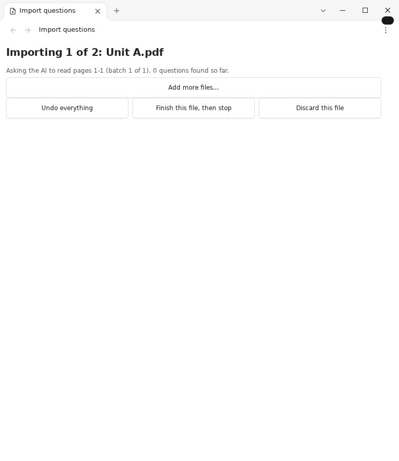

Progress stays in the main window's notice area, so you can keep working while the queue runs:

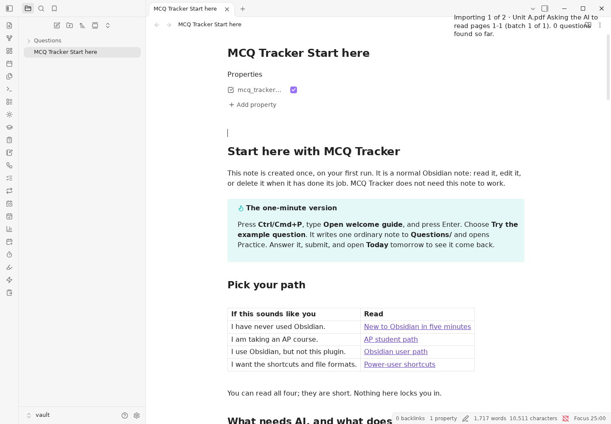

When the batch finishes, the completion popup lists every file and offers **Practice these questions**, which opens Practice limited to the imported folder:

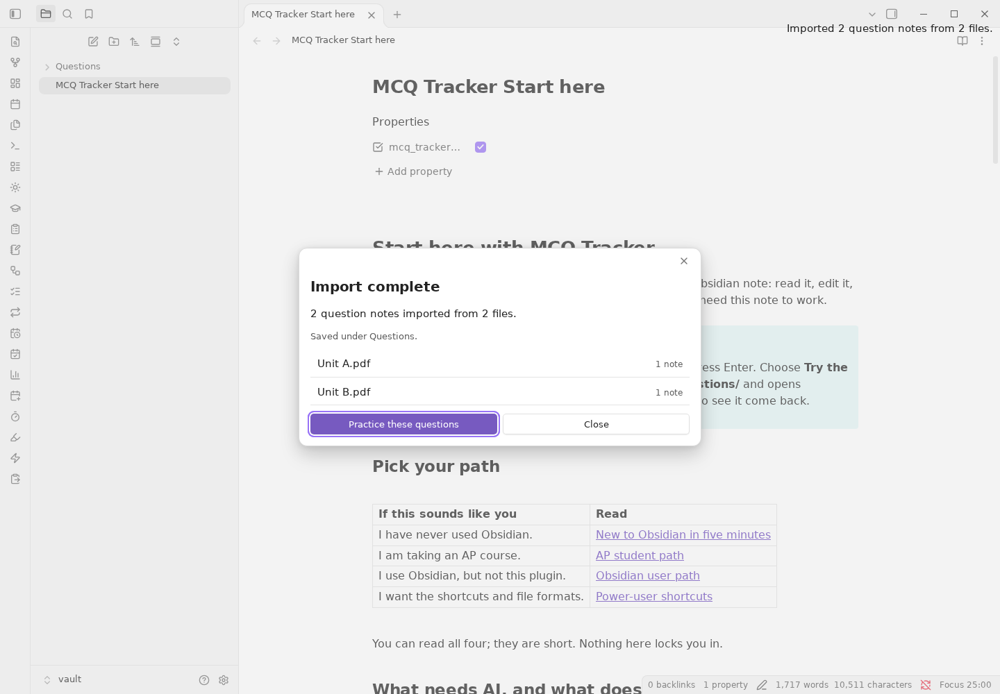

If you stop, the summary reports what was kept and which file was stopped:

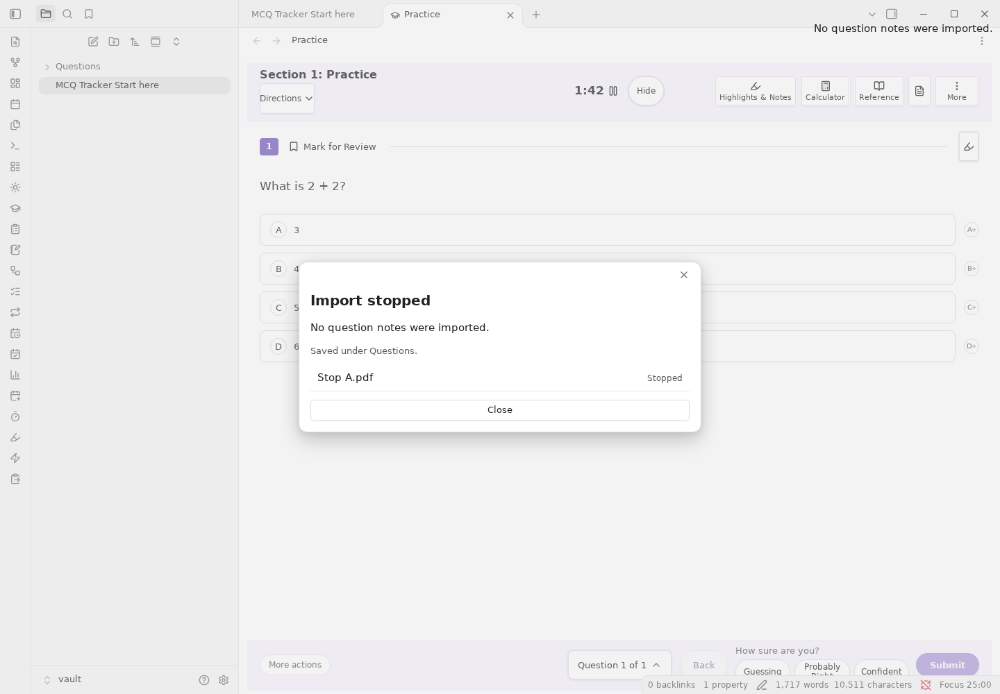

**Local imports.** Ready-made cards can be imported without AI from Quizlet, Kahoot, Moodle XML, QTI, GIFT, `.apkg`, CrowdAnki JSON, Mochi Markdown and Anki text, plus CSV and Markdown. Export a study bundle, a card archive, `.apkg`, ICS, CSV, Markdown or JSON where the format supports it.

### Commands

Open the command palette with `Ctrl/Cmd+P` and search **MCQ Tracker**, **Cards**, **Review**, **Study agent** or **Calendar**. The palette has more than 200 commands, including:

- **Onboarding:** `Open Start here note`, `Open welcome guide`, `Show what's new`.
- **Practice:** `Open practice view`, `Quick Practice`, `Start a timed test`, `Practice this note only`, `Show weak spots`, `Find or generate quiz questions`.
- **Review:** `Open review sidebar`, `Next review note`, `Previous review note`, `Review current note`, `Add current note to review schedule`, `Open review calendar`, `Open study statistics`.
- **Cards:** `Open cards`, `Cards: import existing decks`, `Cards: export to Quizlet, Anki package, Anki text, Mochi, LearnKit, Kahoot, Blooket or Gimkit`, `Cards: find a deck on AnkiWeb`, `Cards: export a portable archive`, `Cards: import a portable archive`.
- **Study agent:** `Study agent: open the sidebar`, `Study agent: Quick Chat`, `Study agent: plan a multi-step task`, `Study agent: attach a PDF`, `Study agent: export a conversation as Markdown`.
- **Calendar:** `Open calendar`, `Open local events`, `Local events: create an event`, `Calendar: add an .ics schedule`, `Calendar: export the visible schedule to .ics`.
- **Data:** `Export a study bundle (backup of questions and cards)`, `Import a study bundle (restore questions and cards)`.

### How it compares with Spaceforge

Spaceforge is a strong spaced-repetition and study suite. This comparison is based on its public README (reference `dralkh/spaceforge` at `1.2.92`) and on this 1.301.2 build. The point is to show the trade-offs, not to claim that one plugin wins every row.

| Capability | MCQ Tracker | Spaceforge | The practical difference |
| --- | --- | --- | --- |
| Whole-note review | Yes: docked bar, review sidebar, due calendar | Yes: docked bar and review sidebar | Both keep the note in view. MCQ Tracker also has question and card lanes that share the same scheduling vocabulary. |
| Spaced repetition | FSRS, SM-2 and a simple ladder | FSRS and SM-2 | MCQ Tracker keeps the ladder for question notes and offers FSRS/SM-2 for whole notes and cards. |
| AI-generated MCQs | Yes, optional, with a blind-verification pass | Yes | Both are BYOK and optional. MCQ Tracker treats generated items as ordinary question notes and can verify the answer key. |
| Adaptive objective tutor | **Partial:** Study agent Objective coach role and local concept record | Yes: dedicated objective rail and per-objective transcripts | MCQ Tracker's coach runs in a saved conversation; it does not have a separate objective dashboard. |
| Web lookup while studying | Local cited vault search only | Optional cited web search | Deliberate: MCQ Tracker does not send study text to a search provider. |
| Anki decks | `.apkg`, AnkiConnect and a separate deck lane | `.apkg`, AnkiConnect and an in-app AnkiWeb browser | MCQ Tracker opens AnkiWeb's search in your browser and imports the downloaded file. |
| AnkiWeb | Finder link; no password stored | Search, inspect and import in the plugin | The download step is outside Obsidian, which keeps the plugin out of AnkiWeb's session. |
| Local calendar events | Yes: categories, recurrence, location, description | Yes, integrated into the main calendar | MCQ Tracker uses a separate **Local events** view; imported classes and exams stay in the Calendar view. |
| Statistics | Heatmap, streaks, retention by maturity, memory-now, distributions, leeches, per-deck | Similar Anki-style dashboard | Both compute locally. MCQ Tracker also has confidence calibration and weak-spot charts. |
| Pomodoro | Work, short break, long break, sound, sidebar and status bar | Yes | Equivalent. |
| Provider breadth | OpenAI, Anthropic, Gemini, OpenRouter, Together, Qwen, Ollama, LM Studio, llama.cpp, Jan, any OpenAI-compatible endpoint, and the OpenCode local agent | 20+ named providers and several agent CLIs | MCQ Tracker's custom endpoint covers the same broad class; OpenCode is the only bundled local agent CLI. |
| Data storage | Review state in each note; settings in `data.json` | One central data file | Deliberate: notes are portable, inspectable and survive a plugin reinstall. There is no custom data-path setting because there is no central review database. |
| Progress carried with the vault | Yes, by design: the progress is in the notes | Optional `progress.json` mirror | A vault sync that excludes `.obsidian` still carries MCQ Tracker review state. Shared settings do not travel that way. |
| Mobile | Yes | Yes | Both use the same Obsidian app. |
| Data export | Study bundle, card archive, `.apkg`, ICS, CSV, Markdown | Central JSON backup and recovery | Different export shapes; both avoid a lock-in. |
| Question-first exam tools | Yes: timed tests, confidence, error tags, numeric/units, FRQ, gradebook, AP tools | No | This is where MCQ Tracker leads. |

**Why the differences exist.** MCQ Tracker deliberately keeps schedules in the notes, keeps web search off the network, and only runs a local agent CLI through OpenCode. Those are product boundaries, not forgotten rows. The full audit, including the Spaceforge rows already closed and the few that remain partial, is in [docs/PARITY_AUDIT.md](docs/PARITY_AUDIT.md).

### Limitations

- The **Objective coach** is a prompt-driven Study agent role. It does not yet have a separate objective rail, per-objective transcript store or automatic transfer test.
- **AnkiWeb** opens in your browser; the plugin does not embed the site or store a session.
- **Web lookup** is deliberately absent. The agent can search your vault, not the web.
- AI output depends on the provider you choose. Generated questions and grades are aids, not an accuracy guarantee.

### Screenshots

These are real captures of the shipped views.

| | |
| --- | --- |
| <a href="docs/images/hero-practice.png"></a> | <a href="docs/images/answer-review.png"></a> |
| <a href="docs/images/cards-review.png"></a> | <a href="docs/images/insights-overview.png"></a> |

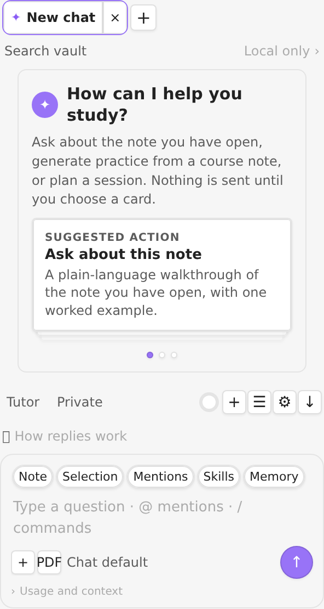

The Study agent at a 296 px sidebar width. A physical-phone screenshot is not included because no device was available for this pass; the mobile layout is covered by the layout tests, and no mockup is presented as a phone capture.

## Data, privacy and network use

- **Review state** is written to each question, card or note in its YAML properties. The plugin's `data.json` holds settings, presets, local events, chat history, the running timer and other plugin state. There is no central review database.
- **No telemetry.** The plugin has no analytics, crash reporting, ads or self-updater.
- **AI is opt-in.** When you send a chat, generate questions or grade an answer, the selected provider receives the text needed for that request. The active provider and the feature that sends are listed in **Settings → Study agent → AI and the assistant**.
- **AnkiConnect** talks only to the local Anki desktop address you configure. **AnkiWeb** opens in your browser; the plugin does not store an AnkiWeb password.
- **CouchDB sync** is optional and only uses the server you configure. **Calendar feeds** are read only when you add them.
- **No web lookup:** the Study agent uses local vault search and cites the notes it actually read. It does not browse the web.

## License and links

[MIT](LICENSE). The plugin sends no telemetry. Third-party notices are in [NOTICES.md](NOTICES.md).

- [Landing page](https://ifriedenson.github.io/mcq-tracker/)
- [Source, releases and changelog](https://github.com/ifriedenson/mcq-tracker)
- [Give feedback](https://tally.so/r/PRDe1d)
- [Report a problem](https://github.com/ifriedenson/mcq-tracker/issues)
- [Sample vault](samples/README.md)
- [Spaceforge parity audit](docs/PARITY_AUDIT.md)
