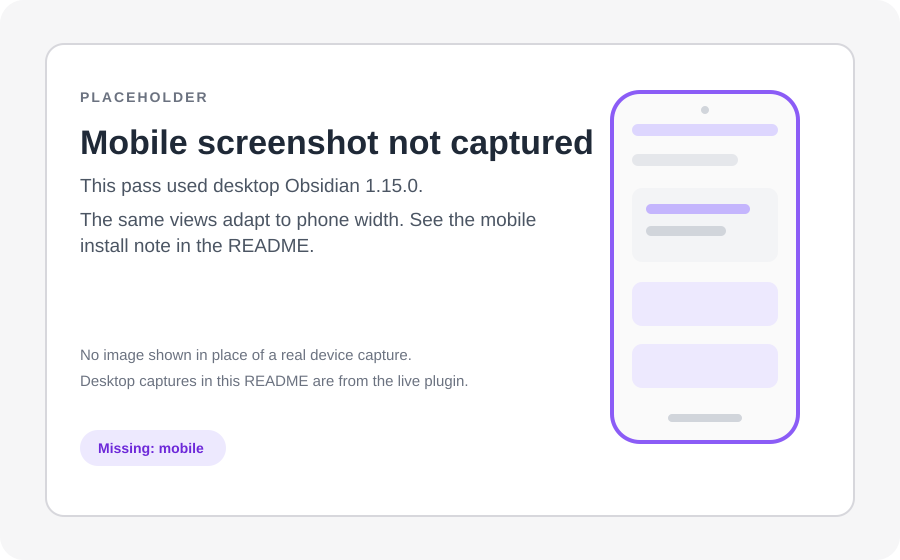

# MCQ Tracker

MCQ Tracker is an Obsidian plugin for practising multiple-choice and free-response questions, reviewing with spaced repetition (short reviews spread over days), and planning study around real exams. It is in the Community Plugins store and works on desktop and mobile. There is nothing else to install and no account to create.

Obsidian is a note-taking app. It keeps your notes in a folder called a **vault**. A **community plugin** is an add-on you install inside Obsidian.


## What it does

- **Practise exam-style questions.** Multiple-choice (MCQ), student-produced response, fill-in, matching, true/false, select-all and free-response (FRQ) questions. Filter by course, skill, difficulty or folder, or build a timed test.
- **Check every answer.** See your pick, the correct answer, the explanation and the next review date. Add a reason for a miss and write a note on the result.
- **Review on a schedule.** A correct answer returns after 1, 3, 7, 21 and 60 days; a miss returns tomorrow. The optional Cards module adds flashcards, vocabulary and cloze cards with the same schedule.
- **Plan and measure.** Optional Calendar and Assignments modules hold classes, exams, deadlines and grades. Insights shows attempts, accuracy, due counts and weak spots from your local notes.
- **Import your own material.** Bring in questions and cards from PDF, PowerPoint, Word/OpenDocument, HTML, RTF, Markdown, CSV or text. AI features are off by default; you can turn them on later.

| Cards and vocabulary | Insights |
| --- | --- |
| <a href="docs/images/cards-review.png"></a> | <a href="docs/images/insights-overview.png"></a> |

## Install

### New to Obsidian?

1. **Download and open Obsidian.** Install it from [obsidian.md/download](https://obsidian.md/download). You should see Obsidian's vault picker.
2. **Create a vault.** Choose a folder for your notes and open it. Obsidian should show an empty file list and a note area.
3. **Open Settings → Community plugins.** The gear is at the bottom-left. You should see **Restricted mode** turned on.
4. **Turn off Restricted mode.** Click **Exit Restricted mode** and confirm. You should see **Browse** and **No plugins installed**.
5. **Browse and search.** Click **Browse**, search for `MCQ Tracker`, and open the result. You should see the plugin page with an **Install** button.
6. **Install and enable.** Click **Install**, then **Enable**. The plugin appears under your installed plugins, and its **Start here** screen may open.


**Already use Obsidian?** Community plugins → Browse → `MCQ Tracker` → Install → Enable.

<details>
<summary>Install on mobile or without the Community Plugins store</summary>

On mobile, open the Obsidian sidebar, tap **Settings**, then **Community plugins**. Turn off Restricted mode, tap **Browse**, search for `MCQ Tracker`, then Install and Enable. The same views and notes work on a phone.



A real mobile screenshot was not captured in this pass; this placeholder marks the gap.

To install manually, download `main.js`, `manifest.json` and `styles.css` from the [latest release](https://github.com/ifriedenson/mcq-tracker/releases/latest) and put them in `<your vault>/.obsidian/plugins/mcq-tracker/`. Then enable **MCQ Tracker** under Community plugins.

</details>

## Quick start

1. On first run, use the **Start here** screen. If it is not open, press `Ctrl/Cmd+P`, type **Open welcome guide**, and press Enter.
2. Click **Try the example question**. MCQ Tracker writes one ordinary note under `Questions/` and opens Practice on that question.
3. Choose an answer, pick how sure you are, and click **Submit**.
4. Read the result. The note keeps your answer, the correct answer, the explanation and the next review date.
5. Open **Today** to see what is due next, or **Open practice** to start another question.


## Settings

Settings are grouped by category, with a page list beside the selected category. The most useful starting switches are under **Settings → App & documents → Modules and global options → Modules**.

| Setting | What it does | Default |
| --- | --- | --- |
| MCQ Tracker | Turns practice, tests, filters and import on or off. Notes stay. | On |
| Cards and vocabulary | Adds flashcards, vocabulary and card review. | Off |
| Calendar | Adds classes, exams and exam-aware study planning. | Off |
| Assignments | Adds the gradebook and task list. | On |
| AI features | Adds tutor, grading and AI-assisted import. Needs your key. | Off |
| Review intervals (days) | Days before a correct answer returns. Misses return tomorrow. | 1, 3, 7, 21, 60 |
| Explanation after answering | When to show the answer explanation. | Only after a miss |


<details>
<summary>Advanced settings and modules</summary>

The optional Study Workspace adds **twenty-one independent modules** and **twenty-one local workflows**, including Feynman, Recall, Time blocks, Reading library and Quiz index. Its settings are on their own pages.

Other settings pages include **Whole-note review**, **Spaced Everything**, **Daily quiz**, **Simple quiz blocks**, **Simple note quiz**, **Decks**, **AnkiConnect**, **CouchDB sync**, **Auto Anki** and **Text2Anki**. Each has its own page or tab.

</details>

<details>
<summary>Question note format</summary>

Any note with a `question_id` property can be a question. A small question note looks like this:

```markdown
---
question_id: BIO-001
course: Biology
skill: Cells
question_type: mcq
answer: B
---

## Question
Which organelle produces most of the cell's ATP?

## Answer Choices
- A. Nucleus
- B. Mitochondrion
- C. Ribosome

## Answer
> [!answer]- Reveal answer
> **Correct Answer: B**
>
> Mitochondria produce ATP by oxidative phosphorylation.
```

`## Stimulus` is optional. You can also add `difficulty`, `unit` and `test` properties, and use `## My Notes` for your own notes. See the [sample vault](samples/README.md) for working notes.

</details>

<details>
<summary>What the plugin writes</summary>

Question attempts, dates, flags and review dates are written to the question note's properties. The plugin's own `data.json` stores settings, presets and the running timer. Your other notes stay ordinary Markdown.

The optional AI and CouchDB sync features use the network only after you turn them on and configure them. AnkiConnect talks only to a local Anki desktop. The plugin sends no telemetry.

</details>

## Troubleshooting

- **I cannot find MCQ Tracker in Browse.** Check that Restricted mode is off, Obsidian is up to date, and the search is `MCQ Tracker`. If it still does not appear, use the manual install above.
- **Practice says there are no questions.** Each question note needs a `question_id` property, a `## Question` heading and an `answer` property. Check **Question folder** in the plugin's Practice settings and clear any folder filter.
- **Cards are missing.** Cards and vocabulary is off by default. Turn it on under **Settings → App & documents → Modules and global options → Modules**.
- **AI or OpenCode does not work.** AI features are off by default. Turn them on under **Settings → App & documents → Modules and global options → Modules**, then add a provider key under **Settings → Study agent → AI and the assistant**. OpenCode is desktop-only; on mobile, use a Direct API provider key.
- **A result did not save.** Keep Obsidian open, press `Ctrl/Cmd+P`, and run **Retry saving offline practice results**. Check that the vault folder is writable.

## License and links

[MIT](LICENSE). The plugin sends no telemetry.

- [Source, releases and changelog](https://github.com/ifriedenson/mcq-tracker)
- [Report a problem](https://github.com/ifriedenson/mcq-tracker/issues)
- [Sample vault](samples/README.md)
- [Third-party notices](NOTICES.md)
